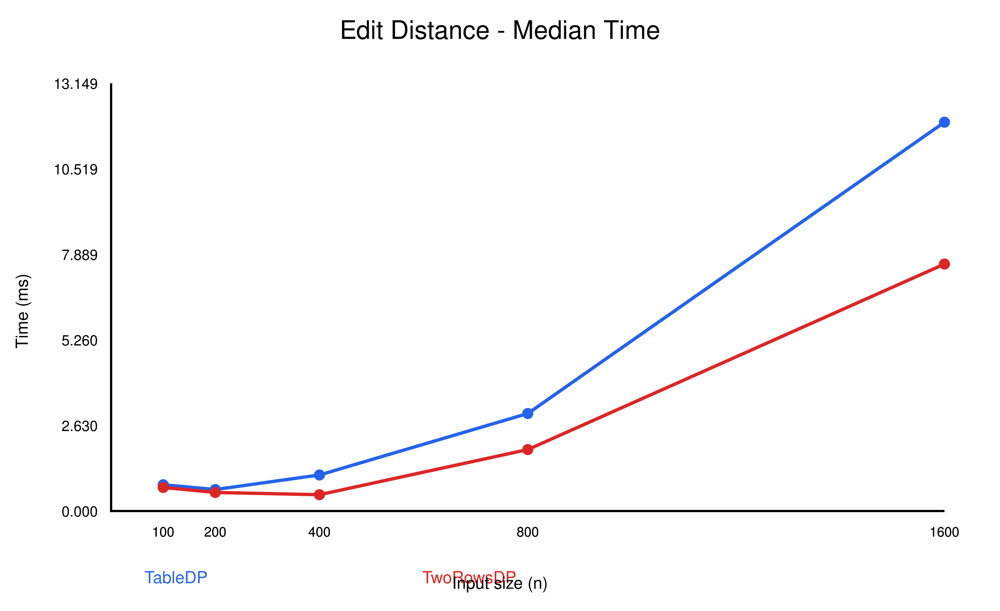
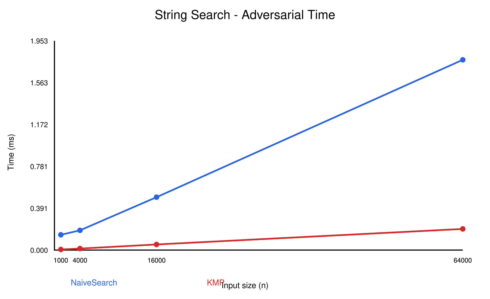
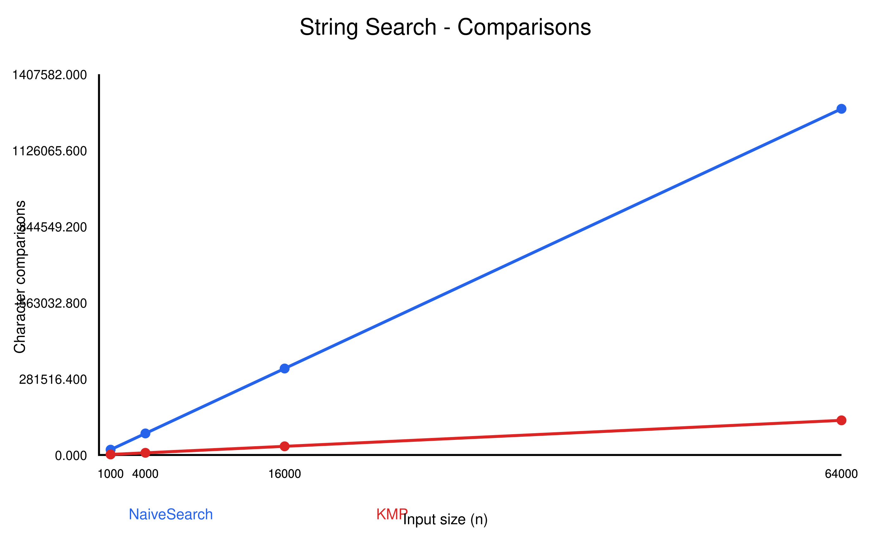
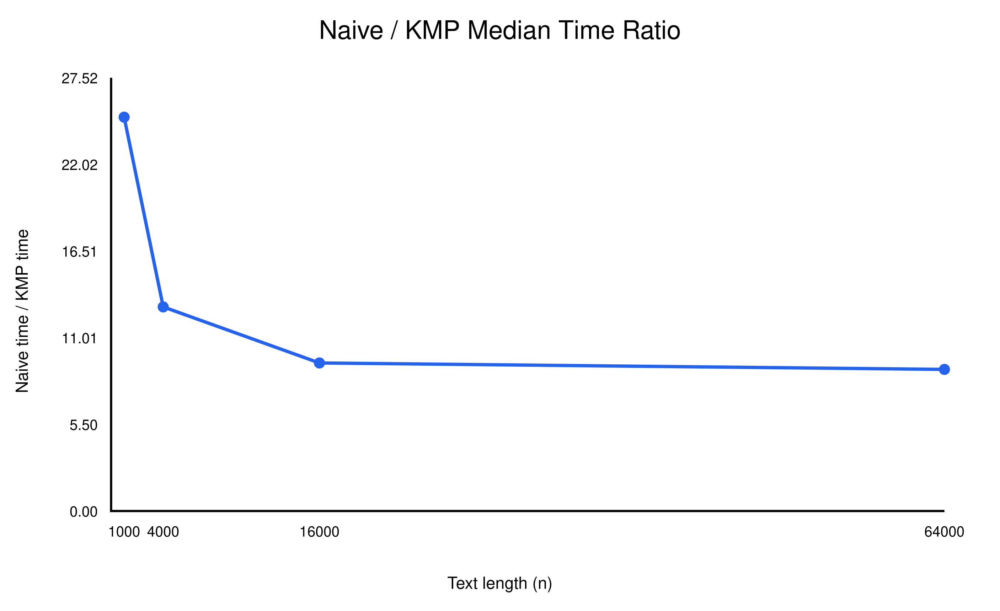

# Assignment 4 — Dynamic Programming and String Algorithms

## Experiment Design Card

### Research Questions

1. How does recursive Edit Distance compare with dynamic programming as input size increases?
2. How do full-table and two-row dynamic programming implementations compare in running time and memory usage?
3. How do Naive Search and KMP perform on random and adversarial inputs?
4. How does the number of character comparisons change as text length increases?

### Algorithms and Input Sizes

| Algorithm | Input sizes |
|---|---|
| Recursive Edit Distance | 4, 6, 8, 10 |
| Table DP and Two-Rows DP | 100, 200, 400, 800, 1600 |
| Naive Search and KMP | 1000, 4000, 16000, 64000 |

For Edit Distance, both strings have length n. For string search, n represents the text length and the pattern length is fixed at m = 20.

### Input Types

**Edit Distance**

- Random: two strings generated using the alphabet ACGT.
- Different: one string consists entirely of A, while the other consists entirely of B.

**String Search**

- Random: text and pattern generated using the alphabet ACGT.
- Adversarial: text consists entirely of A, while the pattern contains 19 A characters followed by B.

The adversarial input causes repeated partial matches in Naive Search, making it useful for comparing the two search algorithms.

### Reproducibility and Measurements

All random inputs use a fixed seed of 42. Each algorithm and input configuration is executed five times. The same inputs are used when comparing algorithms within the same family.

Execution time is measured in milliseconds using System.nanoTime(). The median of five runs is used to reduce the influence of unusually fast or slow measurements.

The following information is recorded in results/results.csv:

- Algorithm name
- Input type
- Input size
- Execution time in milliseconds
- Operation or comparison counter
- Run number

Recursive Edit Distance counts recursive calls. Both DP implementations count computed DP cells. Naive Search and KMP count character comparisons, with KMP also including comparisons during LPS preprocessing.

### Predictions

Recursive Edit Distance is expected to become significantly slower as input size increases because it repeatedly solves overlapping subproblems.

Both dynamic programming implementations should have O(nm) time complexity. The two-row version should use less memory than the full-table version, although their execution times may be similar.

Naive Search is expected to perform poorly on adversarial inputs because it repeatedly compares almost the entire pattern. KMP should perform fewer comparisons by using information stored in its LPS array.

### Planned Plots

1. Input size versus median execution time for Table DP and Two-Rows DP.
2. Text length versus median execution time for Naive Search and KMP on adversarial inputs.
3. Text length versus character comparisons for Naive Search and KMP on adversarial inputs.
4. Naive-to-KMP median execution-time ratio versus text length.

The fourth plot provides a relative comparison of performance.

### Theoretical Complexity

| Algorithm | Time complexity | Auxiliary space |
|---|---|---|
| Recursive Edit Distance | Exponential worst case | O(n + m) |
| Table DP | O(nm) | O(nm) |
| Two-Rows DP | O(nm) | O(min(n,m)) |
| Naive Search | O(nm) | O(1), excluding output |
| KMP | O(n + m) | O(m), excluding output |

## Experimental Results

The experiments produced 220 measurements across the selected input sizes, input types, and algorithms.

### 1. Recursive Edit Distance

| n | Random (ms) | Different (ms) |
|---|---:|---:|
| 4 | 0.0094 | 0.0013 |
| 6 | 0.0713 | 0.0263 |
| 8 | 0.1496 | 0.7736 |
| 10 | 1.3751 | 23.2908 |

Recursive Edit Distance became significantly slower as input size increased.

For completely different strings, the number of recursive calls increased from 481 at n = 4 to 12,146,179 at n = 10. This demonstrates the cost of repeatedly solving overlapping subproblems without memoization.

The differences between random and completely different inputs also show that the exact execution time depends on the input content.

### 2. Dynamic Programming Edit Distance

The following measurements use random inputs.

| n | Table DP (ms) | Two-Rows DP (ms) |
|---|---:|---:|
| 100 | 0.8067 | 0.7249 |
| 200 | 0.6605 | 0.5702 |
| 400 | 1.1081 | 0.5015 |
| 800 | 2.9980 | 1.8889 |
| 1600 | 11.9535 | 7.5918 |

Both implementations compute n × n DP cells when the strings have equal lengths.

At n = 1600, each implementation computed 2,560,000 cells. The two-row implementation was faster in these measurements and requires less auxiliary memory.

The running times did not increase perfectly monotonically for smaller inputs. JVM warm-up, JIT compilation, garbage collection, and background system activity may have affected the results.

### 3. Naive Search vs KMP

The following results use adversarial inputs.

| Text length | Naive (ms) | KMP (ms) | Naive/KMP |
|---|---:|---:|---:|
| 1000 | 0.1426 | 0.0057 | 25.02 |
| 4000 | 0.1841 | 0.0142 | 12.96 |
| 16000 | 0.4937 | 0.0525 | 9.40 |
| 64000 | 1.7756 | 0.1974 | 8.99 |

KMP was faster than Naive Search for every tested adversarial input size.

At n = 64000, Naive Search required 1,279,620 character comparisons, while KMP required only 128,018 comparisons, including LPS preprocessing.

Although both comparison counts increased approximately linearly with text length in this experiment, the pattern length was fixed at 20. Therefore, these results do not contradict the O(nm) worst-case complexity of Naive Search.

## Performance Plots

### Plot 1 — Edit Distance Execution Time

Both dynamic programming implementations became slower as input size increased, consistent with their O(nm) time complexity. The two-row implementation was faster in the measured random-input configurations and uses less memory.

### Plot 2 — String Search Execution Time

Naive Search took longer than KMP on every tested adversarial input. KMP avoids repeating many character comparisons after partial matches, producing a clear execution-time advantage.

### Plot 3 — String Search Comparisons

The number of comparisons increased with text length for both algorithms. However, Naive Search performed approximately ten times as many comparisons as KMP on the largest adversarial input.

### Plot 4 — Naive-to-KMP Time Ratio

The Naive-to-KMP time ratio was greater than 1 for all tested input sizes, indicating that KMP was consistently faster in these measurements. The observed speedup ranged from approximately 9 to 25 times. The decreasing ratio does not imply that KMP becomes asymptotically less efficient.

## Predictions vs Actual Results

The experimental results generally supported the original predictions.

First, Recursive Edit Distance became much slower as input size increased. The rapidly growing number of recursive calls confirmed the expected exponential behavior.

Second, both dynamic programming implementations handled substantially larger inputs than the recursive implementation. Their operation counts matched the expected O(nm) growth. The two-row version also showed lower execution times in the measured random-input configurations, although this advantage is not guaranteed for every environment.

Third, KMP consistently outperformed Naive Search on adversarial inputs. Its comparison counter was much smaller because the LPS array allowed it to avoid unnecessary repeated comparisons.

Finally, the timing results contained some irregularities for smaller input sizes. This was expected because short Java benchmarks are sensitive to JVM optimization and system activity.

## Discussion Questions

### 1. Why is adversarial input important when comparing string search algorithms?

Adversarial input reveals performance differences that may be less visible on random data. In this experiment, Naive Search repeatedly matched many A characters before encountering a mismatch at the final pattern character. KMP used its LPS array to avoid repeating those comparisons. Therefore, adversarial inputs made the difference between the two algorithms easier to observe.

### 2. Why is Recursive Edit Distance limited to small input sizes?

The recursive implementation solves the same subproblems many times because it does not use memoization. As the input size increases, the number of recursive calls grows very quickly. For completely different strings of length 10, the implementation already required more than 12 million recursive calls. This makes the recursive approach impractical for much larger inputs.

### 3. What is the trade-off between full-table and two-row dynamic programming?

Both implementations calculate the same Edit Distance and have O(nm) time complexity. The full-table implementation stores all DP values and therefore requires O(nm) memory. The two-row implementation stores only the rows needed for the next calculation, reducing auxiliary memory to O(min(n,m)). However, the full table is more convenient when the complete sequence of edit operations must be reconstructed.

### 4. Which string search algorithm would you prefer and why?

I would generally prefer KMP when searching for a pattern in a large text, especially when repeated partial matches are possible. Its O(n + m) worst-case time complexity provides a stronger performance guarantee than the O(nm) worst case of Naive Search. The experiments also showed fewer comparisons and lower execution times for KMP on adversarial inputs. However, Naive Search can still be suitable for small inputs because it is simpler to implement and understand.

## Timing Methodology and Limitations

Execution time was measured using System.nanoTime(), with five runs per configuration and the median used for comparison. This reduces the effect of individual outliers, but it does not eliminate all measurement noise. The benchmark did not include a dedicated JVM warm-up phase or direct memory measurements, so JIT compilation, garbage collection, and system activity may have influenced the timings. Operation counters provide additional evidence that is less sensitive to these timing effects. Consequently, the results should be interpreted as observations from this experimental setup rather than universal performance guarantees.

## Conclusions

The experiments demonstrated important differences between recursion, dynamic programming, and string matching algorithms.

Recursive Edit Distance became impractical as input size increased because of repeated subproblem calculations. Both dynamic programming implementations avoided this repeated work and achieved O(nm) time complexity, while the two-row implementation reduced auxiliary space to O(min(n,m)).

For string matching, KMP substantially reduced character comparisons and execution time on adversarial inputs compared with Naive Search. The results supported the theoretical predictions and demonstrated why algorithm selection becomes important as input size increases.

Finally, the experiments highlighted the importance of repeated measurements, median execution times, and operation counters when evaluating algorithm performance.
